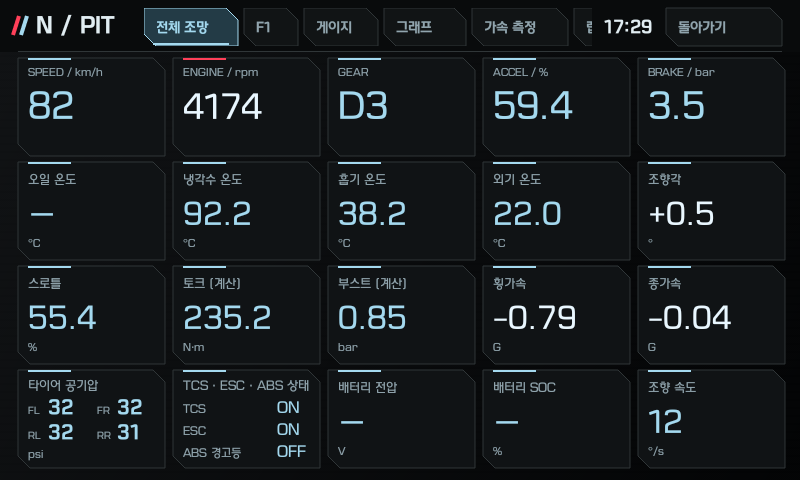
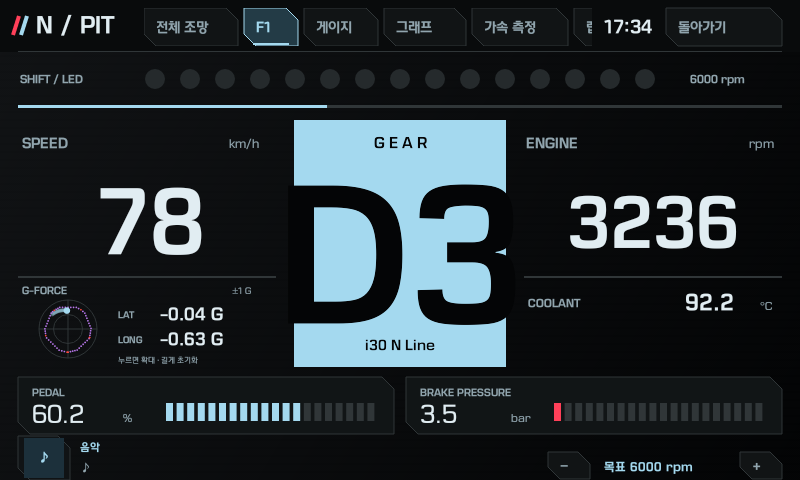
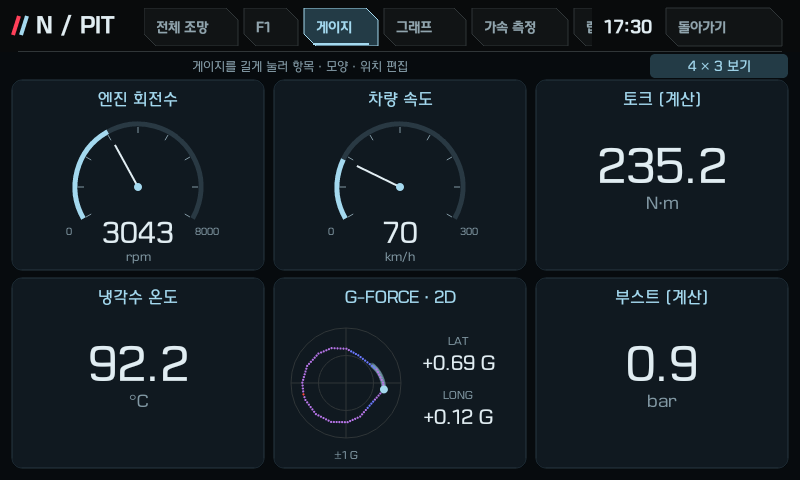
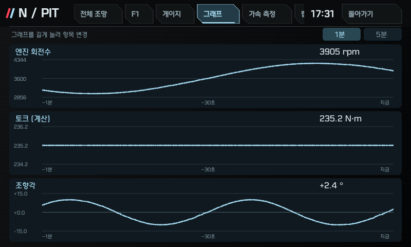
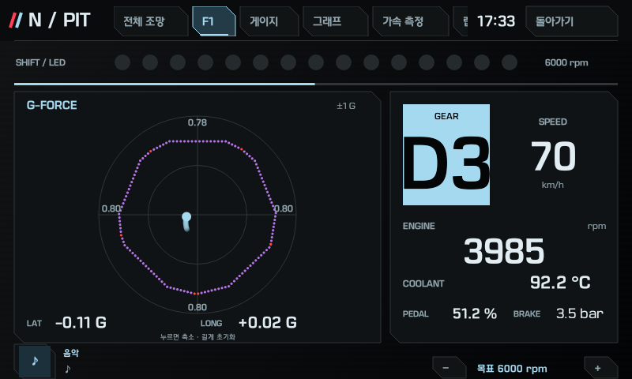
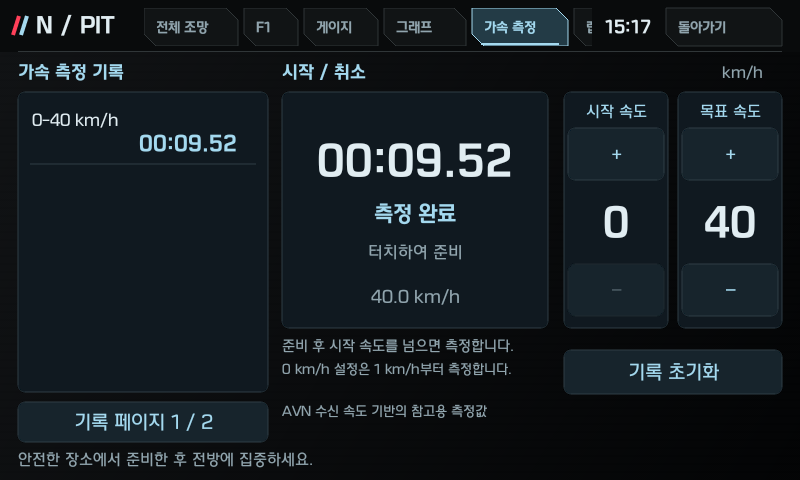
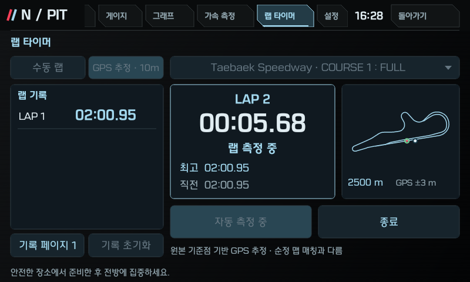
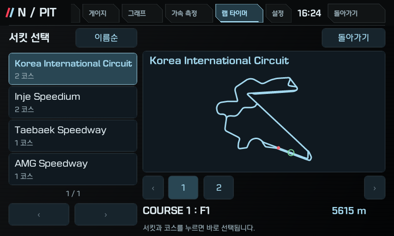
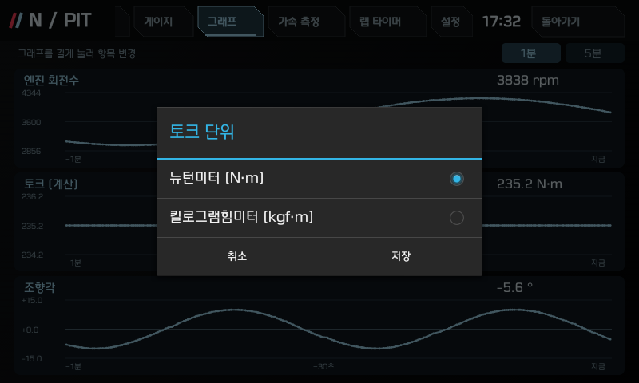

# i30 PD Dashboard

**English** | [한국어](README_ko.md)

Unofficial i30 PD adaptation of [reikop/veloster-n-dashboard](https://github.com/reikop/veloster-n-dashboard).

This fork adds a PD-specific receive decoder and dashboard presentation. Original commits, the unchanged [MIT LICENSE](LICENSE), and upstream notices are retained. Only PD-specific project documentation is included in the current tree. Original author documentation and screenshots are available in the [upstream repository](https://github.com/reikop/veloster-n-dashboard), rather than duplicated here.

## Feature preview

[Overview](#feature-overview) · [F1 dashboard](#feature-f1) · [Editable gauges](#feature-gauges) · [Signal history](#feature-graphs) · [Expanded G-force](#feature-expandedgforce) · [Acceleration test](#feature-accel) · [Lap timer](#feature-lap) · [Circuit and course selection](#feature-circuit) · [Display settings](#feature-settings)

These screenshots show v1.2.0 in the QEMU/API17 emulator with synthetic inputs. They do not establish real-vehicle performance or measurement accuracy. Missing or unsupported readings remain `-`. The app screens are in Korean; descriptions are translated below.

<a id="feature-overview"></a>

### Overview



View received RPM, speed, temperatures, tire pressures and other signals together.

<a id="feature-f1"></a>

### F1 dashboard



Read RPM, speed, gear and shift guidance at a glance, and adjust the target RPM with the lower buttons.

<a id="feature-gauges"></a>

### Editable gauges



Hold a gauge to change its signal, style or position, including a G-force 2D plot.

<a id="feature-graphs"></a>

### Signal history



View one or five minutes of signal history, and hold a graph to choose its signal.

<a id="feature-expandedgforce"></a>

### Expanded G-force



Tap the F1 G-force plot to enlarge its ±1 G range and trail; hold the circle to clear its history.

<a id="feature-accel"></a>

### Acceleration test



Choose start and target speeds, tap the center to arm or cancel, and review completed times in the left-hand list.

<a id="feature-lap"></a>

### Lap timer



Choose manual laps or GPS estimate · 10 m, and review best, previous and completed lap times.

<a id="feature-circuit"></a>

### Circuit and course selection



Select a circuit on the left and a numbered course to apply it immediately and update the map drawn from source COURSE links.

<a id="feature-settings"></a>

### Display settings



Choose and save N·m or kgf·m for torque, and change the app display language in Settings.

[한국어로 보기](README_ko.md#기능-미리보기) · [Back to top](#i30-pd-dashboard)

## Confirmed target and scope

Work was observed on **one Korean Hyundai i30 PD N Line with a 7-speed DCT**, using the factory Gen5 Android 4.2.2/API17 head unit: product `pd_kr`, incremental build `eng.vmadmin.20260114.084130` (firmware `PD.KOR.SOP.V141.260114.STD_H`). Other years, trims, engines, regions, firmware builds and ordinary Android devices have not been validated. The socket receiver retains an exact product/build gate. JSN code remains, but these PD APKs have not been retested on a Veloster N.

## Download and install

Current release APK: [i30-PD-Dashboard-v1.2.0-API17.apk](apks/i30-PD-Dashboard-v1.2.0-API17.apk), **i30 PD v1.2.0** (`versionName=1.2.0-pd`, `versionCode=21`). Adds G-force plots, acceleration and lap timers, source-based course maps and horizontally scrolling tabs. Package name and signing certificate are retained. The exact APK was checked in the ARM32 QEMU/API17 emulator; no new vehicle installation, driving or cold-boot test was performed. See [validation details](docs/PD_VALIDATION.md) and [build provenance](docs/PD_1.2.0_BUILD_PROVENANCE.json).

Download the [v1.2.0 GitHub Release](https://github.com/Linuchan5468/i30-pd-dashboard/releases/tag/v1.2.0). APK SHA-256: `ab52c385496e90fa9affa5384bc41ec022f85e1763da4189a15a0a67d56ab119`. The previous [v1.1.0](https://github.com/Linuchan5468/i30-pd-dashboard/releases/tag/v1.1.0) and [v1.0.0](https://github.com/Linuchan5468/i30-pd-dashboard/releases/tag/v1.0.0) releases remain available.

The last vehicle-installed/readback-matched artifact remains [historical PD v11 / 2.0-pdkr](apks/N-Dashboard-v11-PD-API17.apk), from 2026-10-29. Its initial final-UI check was performed with ignition off and AVN power retained. The owner subsequently confirmed that the app runs after a cold boot and retains its saved settings. These are historical vehicle observations; they do not establish vehicle validation of the newer public releases. [Validation details](docs/PD_VALIDATION.md).

```sh
python3 scripts/verify_release.py
```

[PD installation and launch](docs/INSTALL_PD.md) explains target checks, backups and ADB commands. The inherited `scripts/install.py` and OEM menu tools remain **JSN-profile tools**, not PD installers. They select upstream JSN artifacts; this fork does not publish modified OEM menu APKs. My Apps v10 is retained unchanged as an optional upstream companion. Its configuration and PD limitations are described in the PD installation guide.

APKs use the public AOSP platform test certificate for compatibility. It is not a private publisher identity. No signing private keys are included. See [NOTICE.md](NOTICE.md) and [release.json](release.json).

## PD version policy

PD releases use an independent `MAJOR.MINOR.PATCH` series starting at **1.0.0**. Future fixes increment PATCH, added functionality increments MINOR, and incompatible changes increment MAJOR. Android displays the PD suffix (`1.0.0-pd`); filenames use the public PD version. The internal Android `versionCode` continues increasing from 12 to preserve upgrades from installed code11; it is not the public release number. Original JSN and unchanged My Apps artifacts retain their historical versions. Version numbers do not expand the confirmed vehicle or validation scope.

## PD changes

- G-force 2D plots use a **±1 G** range in F1 and configurable gauges. Tap the F1 plot to expand it; hold to clear its session history. Longitudinal position is reversed for weight-transfer display while numeric signs remain unchanged. The dotted contour uses 16 directional peaks and radius-based colors; 18 recent distinct points are retained.
- **Acceleration test:** select start/target speeds in 10 km/h steps, then arm or cancel. A zero-start test begins at **1 km/h**; other tests begin above the selected start speed. Settings and the ten latest completed results persist. Times are estimated from decoded PD CLU11 receipts. The emulator test recorded 9,521 ms against 9,411 ms at the sender (+110 ms), exceeding the chosen 100 ms comparison threshold. Timing accuracy is not guaranteed.
- **Lap timer:** manual lap buttons or **GPS estimate · 10 m**, with best/previous times and saved completed records. The selector lists four Korean circuits and six courses, then numbered course buttons; selection applies immediately and is locked during measurement. Course maps use the original COURSE link coordinates, with separate KIC GP/Standing and Inje FULL/A shapes. GPS requires precise-location permission and uses source start/goal points with an independent 10 m proximity policy. It does not reproduce factory navigation map matching. Real-vehicle GPS timing is unverified.
- Top tabs scroll horizontally. API17 socket idle reads no longer cause unnecessary HSCAN reconnects.
- Torque display units selectable under **SET → Torque unit** (Korean: **설정 → 토크 단위**). Choose N·m or kgf·m and save; the choice persists across app restarts. The overview, gauge values/scales and graph values/history/axes use the same selected unit. Conversion uses **1 kgf·m = 9.80665 N·m**, with one decimal place. Default is N·m. Received values and power calculations stay in N·m; missing values remain unavailable. Language selection is also under SET.
- PD RPM/speed reception, separate throttle and accelerator-pedal values, coolant/intake/ambient temperatures, brake pressure, steering angle/rate and longitudinal/lateral acceleration.
- P/R/N and D1–D7 display with fresh selector/gear pairing. The owner confirmed P/R/N and every forward gear D1–D7 on the vehicle.
- Four tire pressures; parked cluster comparison was 32/32/32/31 psi. Other encoded units have host conversion tests only.
- TCS/ESC **enabled states** displayed ON/OFF; ABS is labelled as its **warning lamp**, not ABS intervention. The owner confirmed the individual TCS and ESC ON/OFF behavior on the vehicle, including TCS-only disable with ESC remaining ON.
- Estimated net torque/power from received torque inputs, and gauge boost from absolute/ambient pressure. These are research calculations, not measured crankshaft/wheel output or calibrated instruments.
- PD F1 branding (`PD`, `i30 N Line`), larger vehicle-name text, overview layout and target RPM range **3000–6700**, in 100 RPM steps. Existing 6000 defaults/settings are retained.

Missing or invalid data remains `-`. Oil temperature could not be implemented for this vehicle because no usable oil-temperature value was found on the AVN receive path. The vehicle has no e-LSD, so that feature is unavailable. Valid battery SOC/voltage, wheel speeds and actual ABS intervention remain unestablished on the verified PD receive path. Invalid-value policies and numerical mappings include research interpretations. [Detailed limits and evidence](docs/PD_VALIDATION.md).

## Development and provenance

[CHANGELOG](CHANGELOG.md) records actual PD changes; [build guide](docs/BUILD.md) explains external tools and unsigned builds. Synthetic tests require Python and a JDK:

```sh
python3 scripts/test.py --java /path/to/jdk/bin/java
python3 -m unittest discover -s tests -p 'test_*.py'
python3 scripts/generate_translations.py --check
```

No OEM firmware, APK/ODEX implementations, copied OEM artwork, raw vehicle captures, device identifiers, personal settings/backups, SDK binaries or signing keys are added by this PD publication. The circuit catalog contains factual source names, lengths and coordinates; maps and controls are independently rendered. [NOTICE](NOTICE.md) records their provenance. Compile-only OEM declarations are excluded from the app DEX. Receive-only telemetry does not send ECU diagnostic/control commands; explicit My Apps settings/media actions have separate behavior. This is an unofficial research project.

---

**English** | [한국어](README_ko.md)
