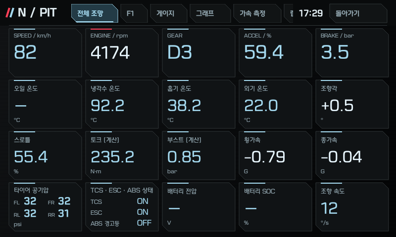
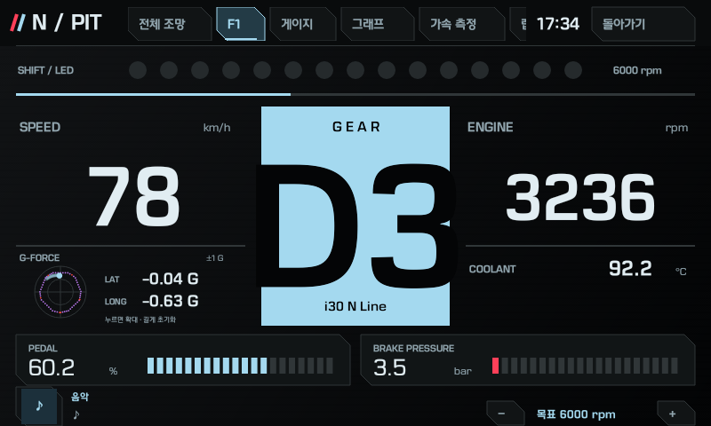
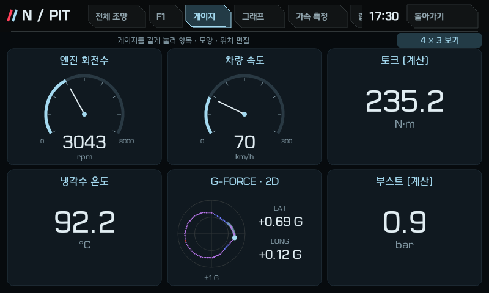
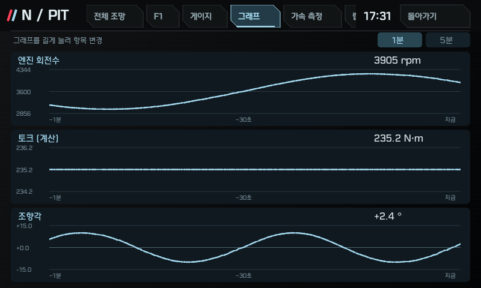
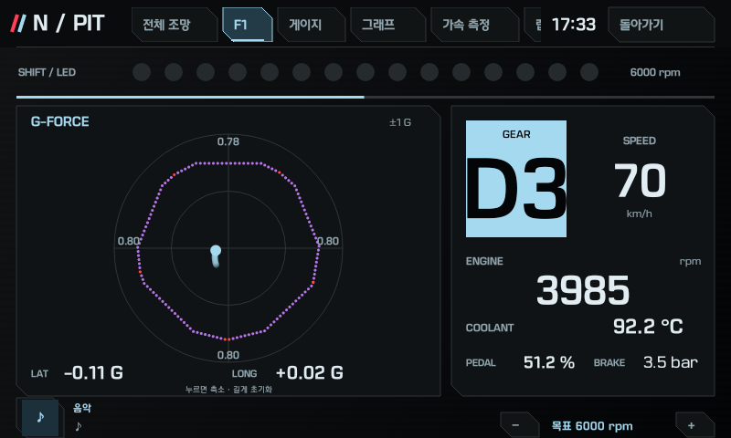
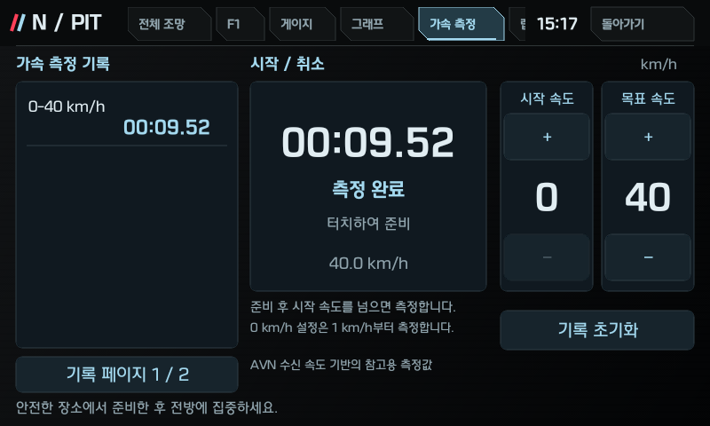
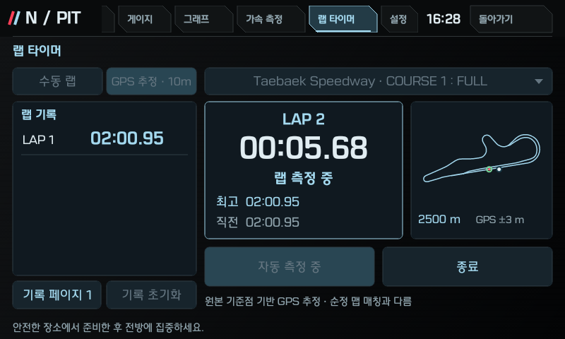
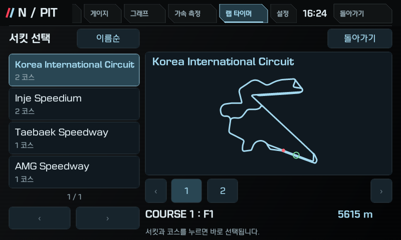
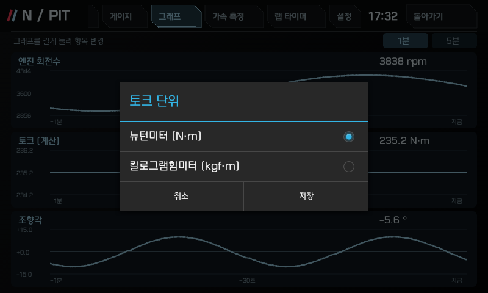

# i30 PD Dashboard

[English](README.md) | **한국어**

[reikop/veloster-n-dashboard](https://github.com/reikop/veloster-n-dashboard)를 기반으로 i30 PD에 맞춰 수정한 비공식 대시보드입니다.

원본 커밋 이력과 [MIT LICENSE](LICENSE)를 유지하며 [NOTICE](NOTICE.md)에 출처·외부 의존성을 기재했습니다. 현재 파일 트리에는 PD용 문서만 제공합니다. 원작자의 설명·검증 문서와 사진·미리보기 이미지는 중복 게시하지 않으며 [원본 저장소](https://github.com/reikop/veloster-n-dashboard)에서 확인할 수 있습니다.

## 기능 미리보기

[전체 조망](#feature-overview) · [F1 계기판](#feature-f1) · [편집 가능한 게이지](#feature-gauges) · [시계열 그래프](#feature-graphs) · [확대 G-Force](#feature-expandedgforce) · [가속 측정](#feature-accel) · [랩 타이머](#feature-lap) · [서킷·코스 선택](#feature-circuit) · [표시 설정](#feature-settings)

아래 화면은 v1.2.0을 QEMU/API17 에뮬레이터에서 실행한 모습이며, 표시값은 합성 입력입니다. 실차 주행 성능이나 계측 정확도를 증명하는 사진은 아닙니다. 미수신·미지원 항목은 `-`로 표시됩니다. 화면은 한국어 앱 UI이며 두 README에서 같은 이미지를 사용합니다.

<a id="feature-overview"></a>

### 전체 조망



RPM·속도·온도·공기압 등 여러 수신 항목을 한 화면에서 확인합니다.

<a id="feature-f1"></a>

### F1 계기판



RPM·속도·기어와 변속 안내를 크게 보고, 하단 버튼으로 목표 RPM을 조절합니다.

<a id="feature-gauges"></a>

### 편집 가능한 게이지



게이지를 길게 눌러 표시 항목·모양·위치를 바꾸고 G-force 2D도 배치합니다.

<a id="feature-graphs"></a>

### 시계열 그래프



항목별 변화 이력을 1분 또는 5분 범위로 보고, 그래프를 길게 눌러 항목을 바꿉니다.

<a id="feature-expandedgforce"></a>

### 확대 G-Force



F1의 G-Force를 눌러 ±1 G 그래프와 궤적을 확대하고, 원을 길게 눌러 기록을 지웁니다.

<a id="feature-accel"></a>

### 가속 측정



시작·목표 속도를 고른 뒤 중앙을 눌러 준비하거나 취소하고, 완료 시간을 왼쪽 기록에서 확인합니다.

<a id="feature-lap"></a>

### 랩 타이머



수동 랩 또는 GPS 추정 · 10m를 선택해 최고·직전 시간과 완료된 랩 기록을 확인합니다.

<a id="feature-circuit"></a>

### 서킷·코스 선택



왼쪽 서킷 목록과 코스 번호를 누르면 선택이 즉시 반영되고 원본 COURSE 링크 지도가 바뀝니다.

<a id="feature-settings"></a>

### 표시 설정



설정에서 토크 단위를 N·m 또는 kgf·m로 고르고 저장하며, 앱 표시 언어도 바꿉니다.

[Read in English](README.md#feature-preview) · [맨 위로](#i30-pd-dashboard)

## 확인된 차량

**한국 사양 i30 PD N Line, 7단 DCT 차량 1대**의 순정 Gen5 Android 4.2.2/API17 AVN에서 작업했습니다. 제품명 `pd_kr`, 빌드 `eng.vmadmin.20260114.084130`, 펌웨어 `PD.KOR.SOP.V141.260114.STD_H`입니다. 다른 연식·엔진·트림·지역·AVN 빌드나 일반 Android 기기 호환성은 확인하지 않았습니다. 수신 연결의 정확한 제품/빌드 제한을 유지했습니다. 기존 JSN 분기는 남아 있으나 PD APK의 Veloster N 재검증은 하지 않았습니다.

## 설치 파일

현재 릴리스 APK는 [i30-PD-Dashboard-v1.2.0-API17.apk](apks/i30-PD-Dashboard-v1.2.0-API17.apk), **i30 PD v1.2.0** (`versionName=1.2.0-pd`, `versionCode=21`)입니다. G-Force, 가속·랩 측정, 원본 좌표 기반 코스 지도와 가로 스크롤 탭을 추가했습니다. 패키지명과 서명 인증서는 유지했습니다. 같은 APK를 ARM32 QEMU/API17 에뮬레이터에서 확인했으며 새 실차 설치·주행·콜드 부팅 검증은 진행하지 않았습니다. [검증 상세](docs/PD_VALIDATION.md), [빌드 출처](docs/PD_1.2.0_BUILD_PROVENANCE.json).

[v1.2.0 GitHub 릴리스](https://github.com/Linuchan5468/i30-pd-dashboard/releases/tag/v1.2.0)에서 APK를 받을 수 있습니다. SHA-256: `ab52c385496e90fa9affa5384bc41ec022f85e1763da4189a15a0a67d56ab119`. 이전 [v1.1.0](https://github.com/Linuchan5468/i30-pd-dashboard/releases/tag/v1.1.0)·[v1.0.0](https://github.com/Linuchan5468/i30-pd-dashboard/releases/tag/v1.0.0) 릴리스도 보존합니다.

마지막으로 실차 설치·재읽기 해시까지 확인한 파일은 [과거 PD v11 / 2.0-pdkr](apks/N-Dashboard-v11-PD-API17.apk)이며, 2026-10-29 설치본입니다. 최초 최종 UI 검사는 시동 종료 후 AVN 전원을 유지한 상태에서 수행했습니다. 이후 사용자가 콜드 부팅 후 앱 실행과 저장된 설정값 유지를 실차에서 확인했습니다. 이는 당시 버전의 실차 기록이며 이후 공개 버전의 실차 검증으로 확대하지 않습니다. [검증 상세](docs/PD_VALIDATION.md).

```sh
python3 scripts/verify_release.py
```

[PD 설치·실행 안내](docs/INSTALL_PD.md)를 따르세요. 기존 `scripts/install.py`와 OEM 메뉴 도구는 **JSN 전용 프로필**을 유지하며 PD 자동 설치 도구가 아닙니다. 변경된 OEM 메뉴 APK는 배포하지 않습니다. My Apps v10은 수정 없이 남긴 선택형 보조 앱입니다. 설정 방법과 PD 확인 범위는 PD 설치 안내에 정리했습니다.

APK는 호환성을 위해 공개 AOSP platform 테스트 인증서로 서명돼 있습니다. 배포자의 비밀 신원 인증서가 아니며 개인키는 포함하지 않습니다. [배포 목록·해시](release.json)와 [NOTICE](NOTICE.md)를 함께 확인하세요.

## PD 버전 정책

PD 공개 버전은 원본과 별개로 **1.0.0**부터 `주.부.수정` 순서로 관리합니다. 이후 수정은 1.0.1, 기능 추가는 1.1.0, 호환되지 않는 변경은 2.0.0처럼 올립니다. Android 표시에는 PD 접미사(`1.0.0-pd`)를 붙이고 파일명에는 공개 버전을 사용합니다. Android 내부 업데이트 번호인 `versionCode`는 기존 설치본 11에서 12로 이어서 증가하며, 공개 버전 순서와 별도로 관리합니다. 원본 JSN과 수정하지 않은 My Apps의 과거 버전은 유지합니다. 버전 번호 변경이 지원 차량·검증 범위 확대를 의미하지는 않습니다.

## 실제 수정 사항

- **G-Force 2D:** F1과 선택형 게이지에서 **±1 G** 범위를 사용합니다. F1 그래프를 누르면 확대되고 길게 누르면 세션 기록을 초기화합니다. 무게중심 표시를 위해 전후 점 위치를 반전했으며 숫자의 원래 부호는 유지합니다. 16방향 최대값의 점선 윤곽·반경별 색상과 최근 서로 다른18개 점을 표시합니다.
- **가속 측정:** 시작·목표 속도를10km/h 단위로 고르고 준비/취소합니다. 시작0 설정은 **1km/h부터**, 나머지는 선택 시작속도를 넘을 때 측정합니다. 설정과 최근 완료기록10개를 저장합니다. 실제 PD CLU11 수신 시각 기반 추정입니다. 에뮬레이터 시험은 송신9,411ms 대비 앱9,521ms로 +110ms였으며100ms 비교 기준을 넘었습니다. 계측 정확도는 보장하지 않습니다.
- **랩 타이머:** 수동 랩 버튼 또는 **GPS 추정 · 10m**, 최고·직전 시간과 완료기록 저장을 제공합니다. 한국4서킷·6코스 목록에서 서킷과 번호 코스를 고르면 즉시 반영되며, 측정 중에는 선택이 잠깁니다. 영암 GP/Standing·인제 FULL/A를 구분한 원본 COURSE 링크 좌표 지도를 표시합니다. GPS는 정확한 위치 권한이 필요하며 원본 기준점에 별도10m 근접 정책을 적용합니다. 순정 Navi 맵 매칭 전체를 이식한 기능은 아니며 실차 GPS 랩 측정은 미검증입니다.
- 상단 탭을 가로로 스크롤할 수 있습니다. API17 소켓의 일시적인 읽기 대기를 통신 단절로 처리하던 문제를 수정했습니다.
- **설정 → 토크 단위**에서 N·m 또는 kgf·m를 고르고 저장합니다. 선택값은 앱 재실행 후에도 유지됩니다. 전체 조망, 게이지 값·눈금, 그래프 현재값·이력·축에 함께 적용합니다. **1 kgf·m = 9.80665 N·m**로 환산해 소수점 한 자리로 표시하며 기본값은 N·m입니다. 수신 원본과 출력 계산은 N·m로 유지하고 미수신 값은 만들지 않습니다. 언어 선택도 같은 설정 메뉴로 이동했습니다.
- PD 전용 RPM·속도 수신, 스로틀/가속 페달 분리, 냉각수·흡기·외기 온도, 브레이크 압력, 조향각·조향 속도, 횡·종가속 처리.
- P/R/N 및 D1~D7 표시. 변속 위치 변경 전 단수를 폐기하고 신선한 위치·단수 수신을 조합합니다. 실차에서 P/R/N 및 전진 D1~D7 전체 표시를 확인했습니다.
- 네 바퀴 공기압. 정차 후 계기판의 32/32/32/31 psi와 수신값을 대조했습니다. 다른 단위는 호스트 변환 검사만 했습니다.
- TCS·ESC **사용 상태** ON/OFF와 **ABS 경고등** 표시. 실제 제어 개입 여부를 표시하는 기능은 아닙니다. 사용자가 실차에서 TCS·ESC의 개별 ON/OFF 동작을 확인했으며, TCS만 해제할 때 ESC가 ON으로 유지되는 것도 확인했습니다.
- 수신 비율·기준토크·RPM으로 계산한 추정 순토크·출력, 절대압과 대기압으로 계산한 게이지 부스트. 실측 엔진/휠 출력이나 교정된 진단값으로 주장하지 않습니다.
- F1의 `PD`·`i30 N Line` 문구와 차명 크기 확대, PD 전체 조망 배치, 목표 RPM **3000~6700 / 100 단위**. 기본값·기존 저장값 6000은 유지합니다.

오일 온도는 AVN 수신 경로에서 사용할 수 있는 값을 확인하지 못해 해당 차량용으로 구현하지 못했습니다. 이 차량에는 e-LSD가 장착되지 않아 해당 기능을 사용할 수 없습니다. 유효한 배터리 SOC·전압, 휠 속도와 ABS 실제 개입은 확인된 PD 수신 경로에서 검증되지 않았습니다. 미수신·무효 값은 `-`로 유지합니다. 일부 수치 정의·무효값 정책은 연구 해석이며, 모든 OEM 상태 정의를 규명한 것은 아닙니다. [검증 범위와 한계](docs/PD_VALIDATION.md), [변경 기록](CHANGELOG.md)을 참고하세요.

## 소스·공개 범위

[빌드 안내](docs/BUILD.md)의 외부 Android 도구로 서명 전 APK를 만들 수 있습니다. 합성 입력 호스트 검사는 다음과 같습니다.

```sh
python3 scripts/test.py --java /path/to/jdk/bin/java
python3 -m unittest discover -s tests -p 'test_*.py'
python3 scripts/generate_translations.py --check
```

PD 공개 변경에는 순정 펌웨어·OEM APK/ODEX 구현·복제한 OEM 그림·원시 차량 캡처·기기 식별자·개인 설정/백업·SDK 바이너리·서명 개인키를 포함하지 않았습니다. 서킷 이름·길이·좌표 등 원본의 사실 데이터를 사용하되 지도와 선택 화면은 독립적으로 그리며, [NOTICE](NOTICE.md)에 출처를 기록했습니다. 컴파일용 최소 OEM 선언은 DEX에 넣지 않습니다. 대시보드 수신은 ECU 진단·제어 명령을 추가 송신하지 않습니다. My Apps의 명시적 설정/미디어 조작은 별도 동작입니다.

---

[English](README.md) | **한국어**
